# Origami-3Dfolder-ai

Papercraft 3D assets for games, as a Claude Code skill. A simple shape is unfolded into a UV dieline. An image
model paints the dieline. Blender folds it back into a textured low-poly GLB. A second GLB shows the flat sheet
folding into the object (morph targets, one clip `Fold`).


[Demo video](docs/demo.mp4), [vertical version](docs/demo_vertical.mp4)

What you get per object:
- `export/<name>.glb`: low-poly mesh, one atlas, WEBP texture, +Y up, ready for Three.js. 25 to 420 KB.
- `export/<name>_fold.glb`: the same object with the clip `Fold` (4 s, 15 morph targets).
- Four review renders (front, left, back, right) and a gate file with the paint metrics.

## Install

As a Claude Code skill, for every project:

```bash
git clone <this repo> ~/.claude/skills/origami-3dfolder-ai
```

Or for one project: copy the folder to `<project>/.claude/skills/origami-3dfolder-ai/`. Claude then picks it up
when you ask for a crate, a table, a papercraft tree and so on. `SKILL.md` holds the instructions it follows.

Requirements:
- Python 3.10+ with numpy, opencv-python-headless and Pillow: `pip install -r requirements.txt`
- Blender 4.x (tested on 4.4), run headless only
- `OPENAI_API_KEY` in the environment for the paint step. Nothing else needs a key.

## Quick start

The crate, end to end. `blender` is the Blender binary (macOS: `/Applications/Blender.app/Contents/MacOS/Blender`).

```bash
S=scripts; A=examples/crate
python3 $S/net.py $A/spec.json $A/layout.json                 # unfold the cube into a cross net
python3 $S/template.py draw $A/layout.json $A                  # template.png: grey faces, fold lines, labels
python3 $S/image.py edit $A/painted.png "$(cat $A/prompt.txt)" $A/template.png --transparent --dry-run
python3 $S/image.py edit $A/painted.png "$(cat $A/prompt.txt)" $A/template.png --transparent   # paid call
python3 $S/template.py clean $A/layout.json $A/painted.png $A/texture.png --review $A/review/01
blender --background --factory-startup --python $S/run_fold.py -- $A review/01
python3 $S/glb_check.py $A/export/*.glb
```

The examples already ship `painted.png`, so you can skip the paid call and run the last three lines for free.

## Net types

| Type | Parameters | Unfolds as | Good for |
|---|---|---|---|
| `box` | `size` [w, d, h], `faces`, `layout` | cross, or tray for flat slabs | crates, table tops, legs, shelves |
| `frustum` | `r0`, `r1`, `h`, `seg`, `cap` | annulus sector (cone), rectangle (cylinder), round caps | trunks, columns, roofs, wheels, tanks |
| `card` | `size` [w, h], `double` | one quad (two with `double`) | windows, ladders, signs |
| `extrude` | `outline` [[y, z]...], `length`, `faces` | two caps plus a band of sides | gable roofs, awnings, flat props |
| `poly` | `verts`, `faces` | unfolded by shared edges, new piece on overlap | any small low-poly mesh |

Any net takes `"thick"` in metres: its faces get a real thickness, inward so the outside keeps the spec size, with
rims on the free edges that take the dieline colour at the boundary. Use it where paper looks wrong: a window frame,
the walls of an open crate or cart, a ladder. Closed boxes already have volume. The fold animation keeps it.
For a thick net that is not opaque, run `python3 scripts/holes.py layout.json texture.png` before folding: it finds
the holes the alpha cuts (panes, ladder gaps) and Blender adds rims around them too, so a frame reads solid.


A spec places nets as parts (`at`, `rot`, `scale`). One net placed many times shares its pixels. Every net gets the
same texel density. Trees come from `tree.py`: a cone trunk, cone branches and leaf cards cut from a leaf sheet.
Each leaf card is the leaf's bounding rectangle, 2 triangles, and alpha clip cuts the shape (spec `"leaf_card": "quad"`,
the default). `"hull"` follows the leaf outline instead: about 7 triangles per leaf, 3.5 times more, for the same look.

## Rounded shapes

Stacked frustums read square: a pumpkin of three 12-sided bands has a 12-sided outline with corners at each band.
Real-time engines have no tessellation stage (WebGL, WebGPU), so the rounding is baked in Blender before the export:

```json
"round": {"nets": ["low", "belly", "top"], "cuts": 3, "bulge": 0.07, "lobe": 0.04}
```

`bp_round.py` welds the listed nets, subdivides them `cuts` times and moves every vertex to a rounded profile: the
original rings smoothed by Chaikin cuts, a `bulge` in the middle, and a rib on each painted panel with a groove of
depth `lobe` on each fold line. UVs follow the subdivision, so the painting stays valid: no new image. Boxes, roofs
and cards are left sharp. The fold clip still folds the faceted paper.

The bands then meet without a crease, and two things showed the seam instead. The painter shades each band a little
differently, and a band turned upside down in the atlas turns its normal map tangents too. `seamfade.py` fixes both:

```bash
python3 scripts/seamfade.py $A/layout.json $A/texture_src.png $A/texture.png --nets low,belly,top
python3 scripts/maps.py $A
python3 scripts/seamfade.py $A/layout.json $A/normal.png $A/normal.png --nets low,belly,top --flat --depth 12
```

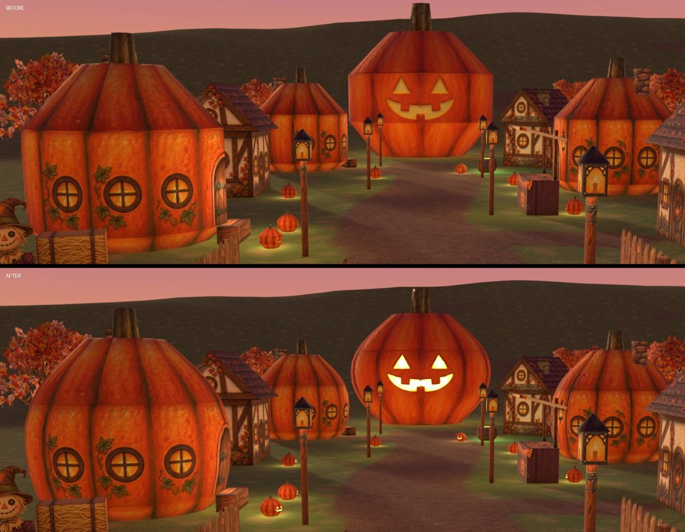

Pumpkin house 134 to 597 faces, jack-o'-lantern 92 to 489, cauldron 68 to 386 (`examples/pumpkin_hollow`).

## Examples

`examples/` holds twelve finished assets, plus the twelve assets of the Pumpkin Hollow level in `pumpkin_hollow/`. Each has its spec, prompt, layout, raw painting, cleaned texture and both
GLBs. Each image below shows the dieline sent to the painter, the painting that came back, and the folded object.

Crate: one box, cross net.


Window: one card with a 6 cm `thick` frame, panes cut out by alpha.


Table: a tray net top and one leg net placed four times.


Tree: cone trunk and branches. The leaves are cards cut from a separate leaf sheet.


Morris column: five frustums. The cornice is a frustum turned upside down.


Market stall: boxes and an extruded gable awning.


Handcart: an open box with 2.5 cm `thick` plank walls, an axle, wheels as short cylinders with both caps.


Water tower: a capped cylinder tank, a cone roof, box legs and a `thick` card ladder.


Flintlock: the image model refused to paint a pistol dieline. So it painted a sheet of plain material
swatches instead (brass, walnut, steel), and `swatch.py` placed them on each piece by code. Stock and lock are
extruded profiles, barrel, band and ramrod are cylinders, the trigger guard is a loop cut in a `thick` card.


## Improvements, before and after

Each GIF flips between the result before and after one tool. Stills: the `.jpg` next to each GIF.

| | |
|---|---|
| 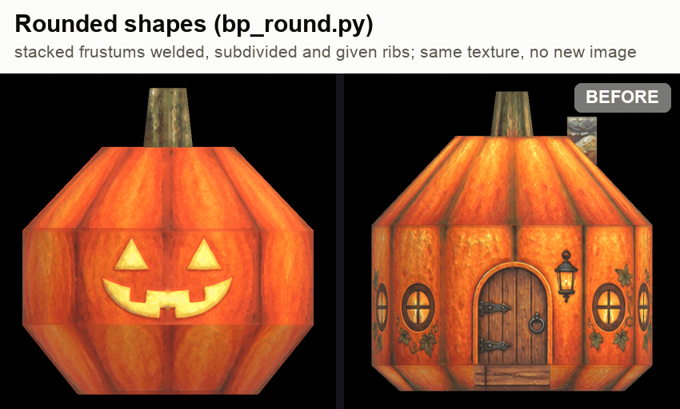 | **Rounded shapes** (`bp_round.py`, spec `"round"`): stacked frustums welded, subdivided and given ribs on the painted panels. Same texture. |
| 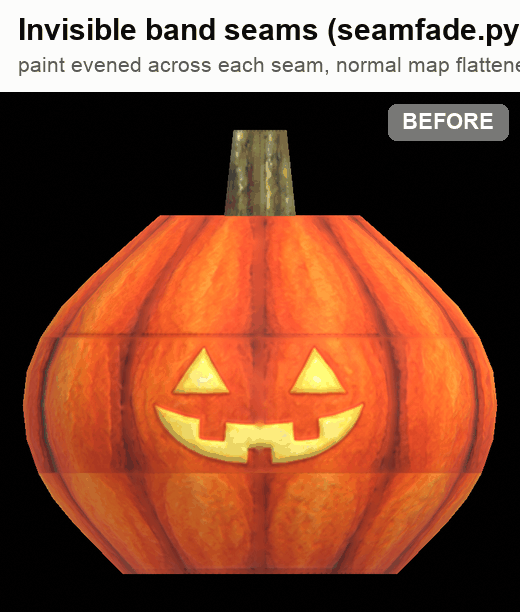 | **Invisible band seams** (`seamfade.py`): paint evened across each seam, normal map flattened there. |
| 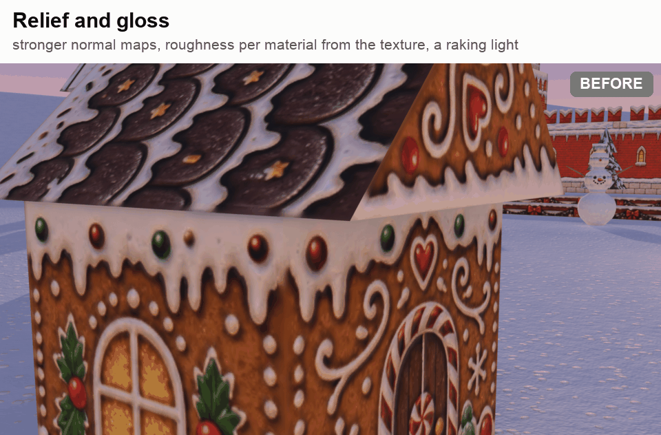 | **Relief and gloss**: stronger normal maps, roughness per material from the texture, a raking light. |
| 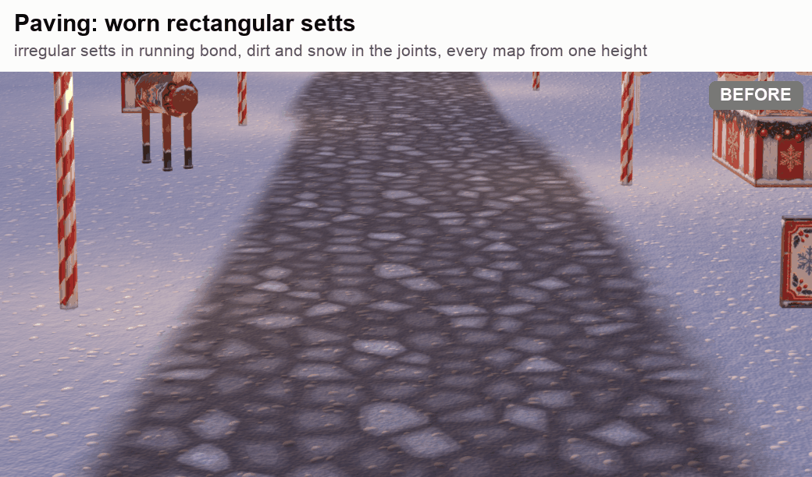 | **Worn rectangular setts** (scene tool `setts.py`): irregular setts in running bond, chips, cracks, dirt and snow in the joints, colour, normal and AO from one height map. |
| 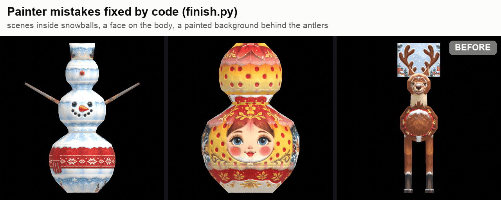 | **Painter mistakes fixed by code** (`finish.py` and `references/advanced.md`): scenes inside snowballs, a face on the body, a painted background behind antlers. |
| 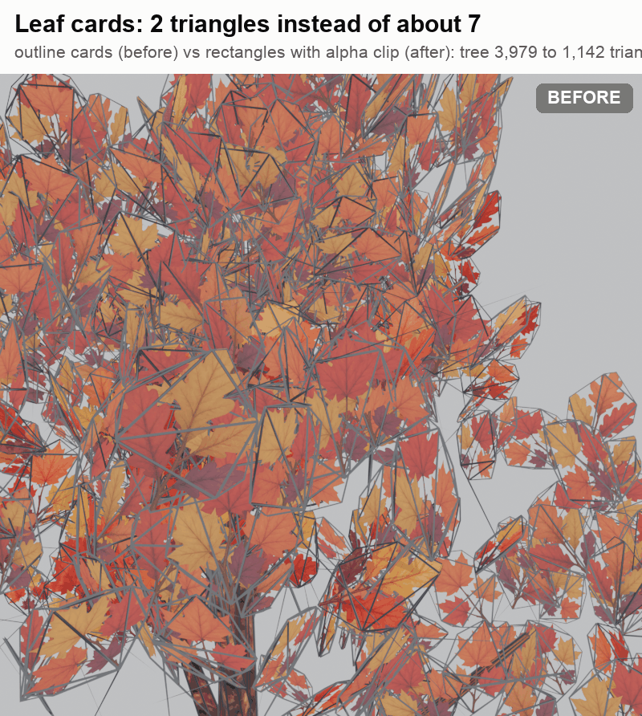 | **Leaf cards of 2 triangles** instead of about 7 (outline cards): a tree drops from 3,979 to 1,142 triangles, same look. |

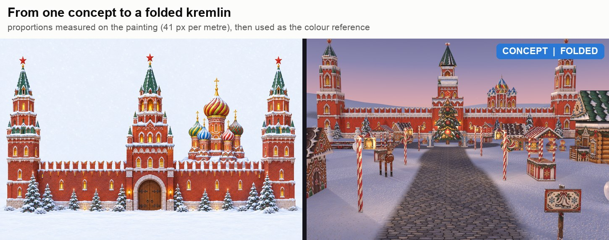

One concept painting set the proportions and the colours of the four fortress buildings.

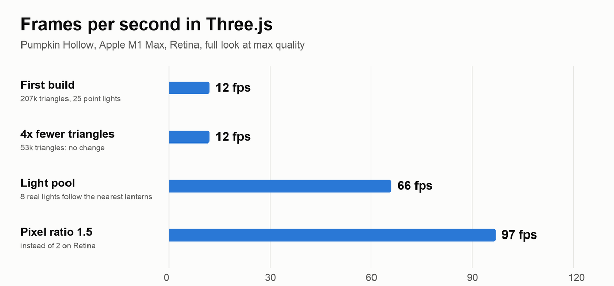

Polygons were not the cost: 4x fewer triangles changed nothing. 25 point lights were. Those two fixes (a pool of 8
lights, a pixel ratio cap) live in the scene tool, not in this repo.

## A whole level: Pumpkin Hollow

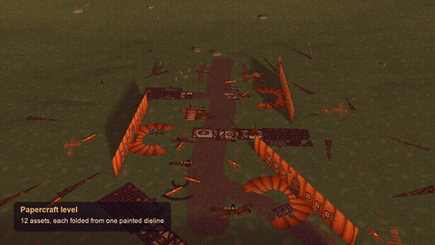

[Video with captions and stats](docs/pumpkin_hollow.mp4)

A Halloween village made only of folded assets. 12 assets in `examples/pumpkin_hollow/`: pumpkin house, cottage,
candy stall, cauldron, lamp post, jack-o'-lantern, scarecrow, hay bale, fence, signpost, gravestone, autumn tree.
13 images in total (12 dielines and one leaf sheet), about $1.30, no 3D generation credit.

The level places them 75 times along a dirt path. Every piece plays its own `Fold` clip, started later the further
it stands along the path, so the village folds up in a wave. Lights switch on when their piece has folded.
The layout, terrain and camera come from a separate scene tool that is not part of this repo.

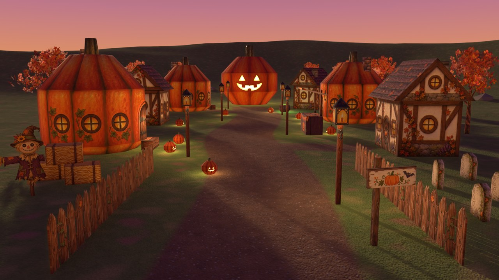

Numbers for the level: 72k triangles with the rounded pumpkins (53k before rounding, 207k in the first build with
leaf cards cut to each leaf outline). 97 FPS in Three.js on an Apple M1 Max with the full look at max quality
(measured at 53k triangles). EEVEE renders a 1080p frame with ray tracing in 1.2 s.

Lessons:
- A cylinder strip starts its seam at the front (-Y). A door painted in the middle of the strip needs the part at
  `"rot": [0, 0, 180]`.
- The painter once put plain planks on the front slope of a gable roof. Copying the shingles from the back slope,
  turned 90 degrees, fixed it without a new image (`cottage/texture.png`; `painted.png` is the raw output).
- Cut-out cards (fence, scarecrow) score a low `iou_fit` by design: the check compares against the full card.

## A second level: Gorod Zimy

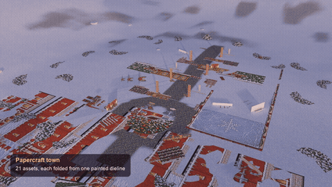

[Video with captions and stats](docs/gorod_zimy.mp4)

A Slavic winter town at New Year: a kremlin wall with swallowtail merlons, towers and a gate, an onion dome church,
a carved terem, gingerbread houses, sweets kiosks, a New Year tree, a skating rink, Ded Moroz, Snegurochka,
snowmen, a polar bear, reindeer, a troika and matryoshkas. 21 assets, 79 placements on a snow field.
22 images in total (21 dielines and one concept), about $2.20, no 3D generation credit.

The fortress started from one concept image of the whole ensemble, front elevation. Its proportions were measured
on it (41 px per metre for a 5 m wall) and it was sent as the second image of each fortress edit, so the four
buildings share the same bricks, trim, green spires and ruby stars. The onion dome, the snowmen and the dolls use
`"round"`. The painter's mistakes (little village scenes inside snowballs, a face on the doll's body, a painted
background behind the antlers) were all fixed by code, now in `finish.py` and `references/advanced.md`.

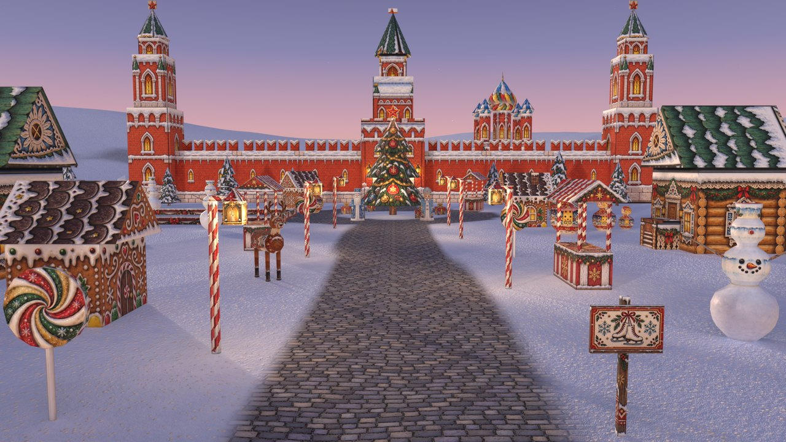

Numbers for the level: 39k triangles (terrain 20k, the 78 folded pieces 19k), 96 to 120 FPS in Three.js on an
Apple M1 Max with the full look at max quality, 9,000 falling snowflakes in the Blender video. Its assets are not
in `examples/` yet.

## No fold lines

The painter tends to keep the dark fold lines of the template. `template.py clean` repaints a thin band along every
face edge from the colours around it, so the folded object shows no seam lines. Pass `--keep-lines` for an outlined
cartoon look.

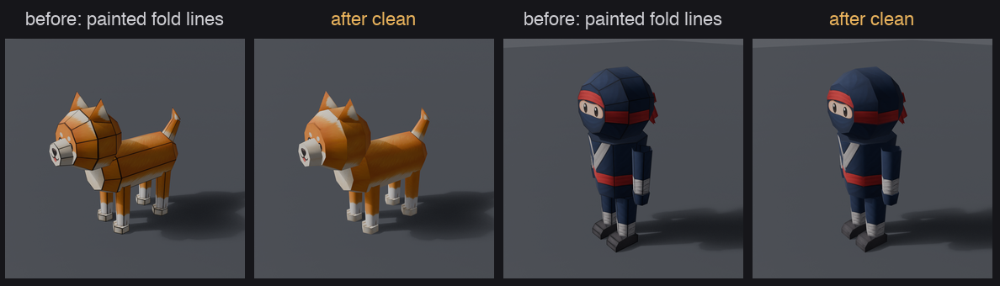

## Relief (normal maps)

`python3 scripts/maps.py ASSET_DIR` infers a normal map and an occlusion map (`ao.png`) from the painted texture:
free, no image call. Height is
guessed from brightness, then turned into clamped slopes, so wood grain, plank edges, rivets and staves catch the
light. `run_fold.py` plugs `normal.png` into the material and the GLB ships it as `normalTexture`. Strength 3 by
default; characters use `"normal_strength": 1.5` in their spec so painted eyes do not turn into bumps.

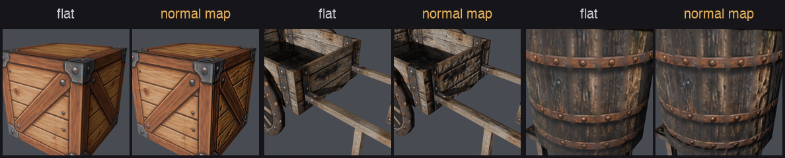

## Alive: blink, talk, flowing water

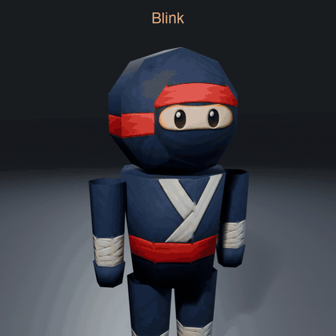

[Video](docs/alive.mp4). Three kinds of glTF clips ship next to `Fold`, in the static and the fold GLB:
- `Blink` and `Talk`: one image edit paints every face variant at once (`expressions.py`: the current face disks on
  top of a sheet, grey disks below). Each variant is a disk just in front of the face, collapsed at rest and opened
  by a stepped morph target. Standard glTF, any viewer plays it.
- `Flow`: water built by code (`water.py`: looping ripples and a falling veil) on disks and veils listed in the spec
  under `"water"`. The texture scrolls through `KHR_texture_transform`, animated by `KHR_animation_pointer`. Each
  loop ends on a whole tile, so it has no seam. Three.js needs a loader plugin for `KHR_animation_pointer`, or a
  few lines that move `material.map.offset` of the water materials.

Fountain: stone painted by the image model, water by code.
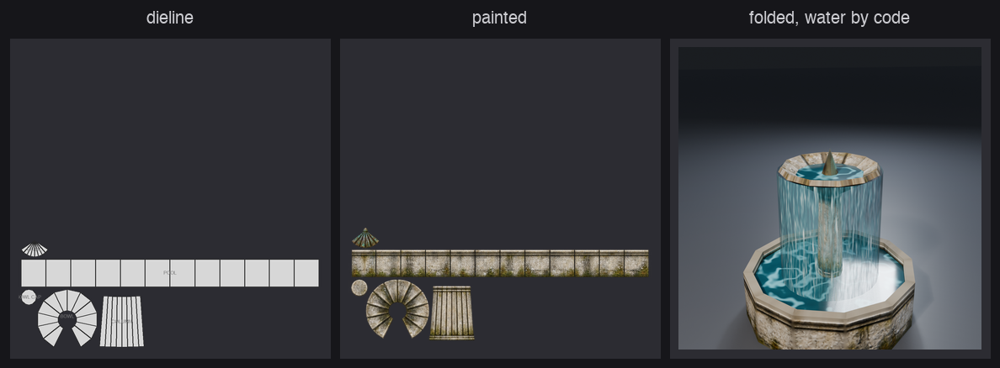

## Render look

`scripts/bp_look.py` lights the demo renders: a warm key with readable shadows, a cool fill, a rim light that
separates the silhouette, a sky to ground gradient, and EEVEE ray tracing for screen space occlusion (the EEVEE
take on SSAO) and reflections. The GLB also ships `occlusionTexture` (`ao.png` from `maps.py`) and a soft specular.

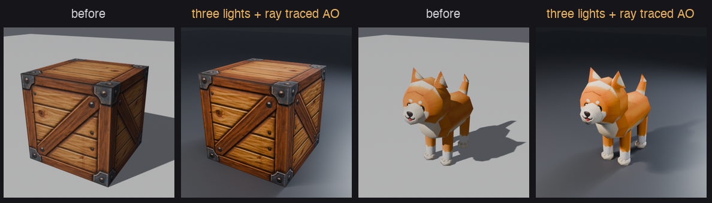

## Characters

Rounded low-poly characters work too. A head is three frustums along the view axis: a front bevel with the face on
its end disk, a band, a back bevel. Torso, arms and legs are tapered cylinders, hanging parts use `"flip"`.
One painting per character. [Video](docs/characters.mp4), [vertical](docs/characters_vertical.mp4).

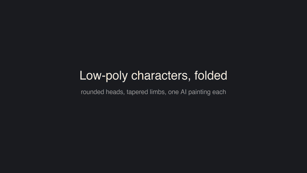

Chibi ninja: 104 faces, 54 KB.
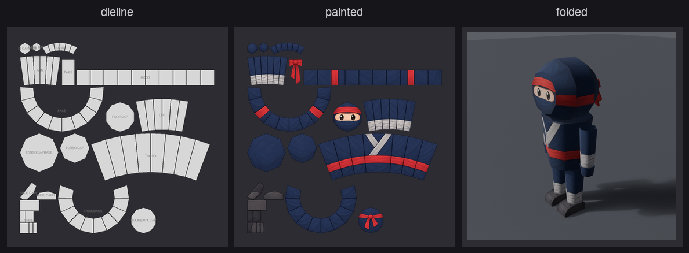

Shiba dog: 141 faces, 74 KB.
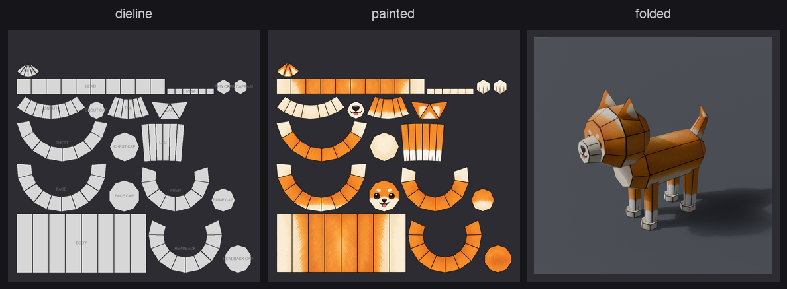

## From a printable sheet (free)

Already have a printable papercraft (solid cut lines, dashed fold lines, white glue flaps)? Fold it as is:

```bash
python3 scripts/printfold.py sheet.png examples/my_model     # texture.png, layout.json, read.json, read_debug.png
python3 scripts/maps.py examples/my_model
blender --background --factory-startup --python scripts/run_fold.py -- examples/my_model
```

- `printable.py` reads the sheet: pieces, fold lines, regions, glue flaps, faces and hinges. Check `read_debug.png`.
- `printfold.py` solves one angle per hinge so each flap edge lands on another face. Faces cut along curves (wings,
  claws) stay near flat. A small piece whose lines meet in one point is rolled into a cone and set on the top face.
- The front is the face with the most drawing. Its two biggest marks are read as eyes, so the face comes out upright.
- No image call and no painting: the sheet is the texture. Use sheets you have the rights to.

## Fold animation

`<name>_fold.glb` plays the flat sheet folding into the object. Box and card faces turn about their shared edges.
Cones roll up without stretching the paper. Parts fold in spec order. Leaves grow last.


## Fallbacks

- `swatch.py`: when the image model refuses the object, paint one sheet of plain material swatches and place them
  per net or per face.
- `silhouette.py`: one side photo becomes an extruded profile with the photo on both caps. No image call.

## Costs

- About $0.10 to $0.25 per painted image (one per object, plus one leaf sheet per tree species).
- Everything else is free and local: unfolding, cleanup, folding, export, renders.
- `image.py --dry-run` prints the request and sends nothing. The skill asks before every paid call.

## Limits

- Simple shapes only. Organic forms (characters, rocks, roots) do not unfold well.
- The painter keeps shapes but not always scale. `template.py clean` fits it back and the gate checks it.
- A layout is tied to its painting. Change the spec and you repaint.
- Image moderation can refuse some objects (weapons). Use the swatch fallback, do not reword around the filter.
- The tree fold GLB is large (2.3 MB) because of 15 morph targets on 5240 verts.

## Tests

```bash
pip install pytest && python3 -m pytest tests
```

The tests cover the pure Python parts: every example layout folds back exactly, keeps its edge lengths mid fold
and starts flat, plus nets, caps, the paint cleanup and the gate. `test_printable.py` draws a cube sheet by code
and checks that the reader folds it shut.

## License

Code: [Apache License 2.0](LICENSE). Use it anywhere, commercial projects included. Keep the [NOTICE](NOTICE) file
in a redistribution or a fork.

Example assets in `examples/` (images, textures, GLB): [CC BY 4.0](examples/LICENSE). Free to reuse, with a credit
to lejrimostfa and a link to this repo.

If it helps your game or your video, a mention or a link is appreciated. GitHub's "Cite this repository" button
gives a ready citation ([CITATION.cff](CITATION.cff)).
