# Origami-3Dfolder-ai

Papercraft 3D assets for games, as a Claude Code skill. A simple shape is unfolded into a UV dieline. An image
model paints the dieline. Blender folds it back into a textured low-poly GLB. A second GLB shows the flat sheet
folding into the object (morph targets, one clip `Fold`).

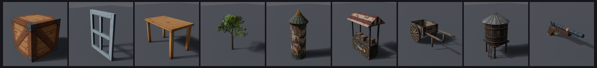

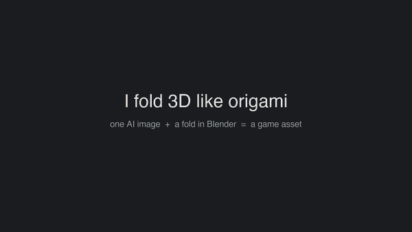

[Demo video](docs/demo.mp4), [vertical version](docs/demo_vertical.mp4)

What you get per object:
- `export/<name>.glb`: low-poly mesh, one atlas, WEBP texture, +Y up, ready for Three.js. 25 to 420 KB.
- `export/<name>_fold.glb`: the same object with the clip `Fold` (4 s, 15 morph targets).
- Four review renders (front, left, back, right) and a gate file with the paint metrics.

## Install

As a Claude Code skill, for every project:

```bash
git clone <this repo> ~/.claude/skills/origami-3dfolder-ai
```

Or for one project: copy the folder to `<project>/.claude/skills/origami-3dfolder-ai/`. Claude then picks it up
when you ask for a crate, a table, a papercraft tree and so on. `SKILL.md` holds the instructions it follows.

Requirements:
- Python 3.10+ with numpy, opencv-python-headless and Pillow: `pip install -r requirements.txt`
- Blender 4.x (tested on 4.4), run headless only
- `OPENAI_API_KEY` in the environment for the paint step. Nothing else needs a key.

## Quick start

The crate, end to end. `blender` is the Blender binary (macOS: `/Applications/Blender.app/Contents/MacOS/Blender`).

```bash
S=scripts; A=examples/crate
python3 $S/net.py $A/spec.json $A/layout.json                 # unfold the cube into a cross net
python3 $S/template.py draw $A/layout.json $A                  # template.png: grey faces, fold lines, labels
python3 $S/image.py edit $A/painted.png "$(cat $A/prompt.txt)" $A/template.png --transparent --dry-run
python3 $S/image.py edit $A/painted.png "$(cat $A/prompt.txt)" $A/template.png --transparent   # paid call
python3 $S/template.py clean $A/layout.json $A/painted.png $A/texture.png --review $A/review/01
blender --background --factory-startup --python $S/run_fold.py -- $A review/01
python3 $S/glb_check.py $A/export/*.glb
```

The examples already ship `painted.png`, so you can skip the paid call and run the last three lines for free.

## Net types

| Type | Parameters | Unfolds as | Good for |
|---|---|---|---|
| `box` | `size` [w, d, h], `faces`, `layout` | cross, or tray for flat slabs | crates, table tops, legs, shelves |
| `frustum` | `r0`, `r1`, `h`, `seg`, `cap` | annulus sector (cone), rectangle (cylinder), round caps | trunks, columns, roofs, wheels, tanks |
| `card` | `size` [w, h], `double` | one quad (two with `double`) | windows, ladders, signs |
| `extrude` | `outline` [[y, z]...], `length`, `faces` | two caps plus a band of sides | gable roofs, awnings, flat props |
| `poly` | `verts`, `faces` | unfolded by shared edges, new piece on overlap | any small low-poly mesh |

Any net takes `"thick"` in metres: its faces get a real thickness, inward so the outside keeps the spec size, with
rims on the free edges that take the dieline colour at the boundary. Use it where paper looks wrong: a window frame,
the walls of an open crate or cart, a ladder. Closed boxes already have volume. The fold animation keeps it.
For a thick net that is not opaque, run `python3 scripts/holes.py layout.json texture.png` before folding: it finds
the holes the alpha cuts (panes, ladder gaps) and Blender adds rims around them too, so a frame reads solid.

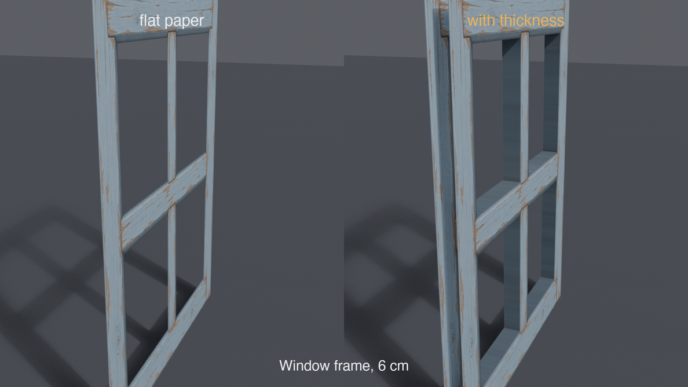

A spec places nets as parts (`at`, `rot`, `scale`). One net placed many times shares its pixels. Every net gets the
same texel density. Trees come from `tree.py`: a cone trunk, cone branches and leaf cards cut from a leaf sheet.

## Examples

`examples/` holds nine finished assets. Each has its spec, prompt, layout, raw painting, cleaned texture and both
GLBs. Each image below shows the dieline sent to the painter, the painting that came back, and the folded object.

Crate: one box, cross net.
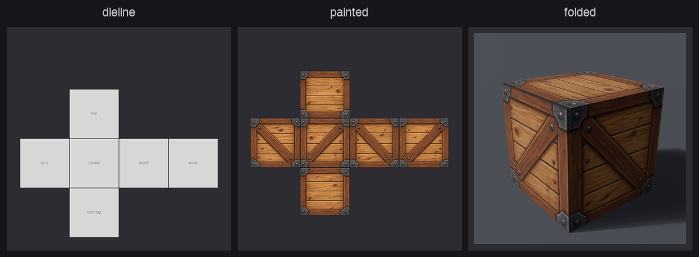

Window: one card with a 6 cm `thick` frame, panes cut out by alpha.
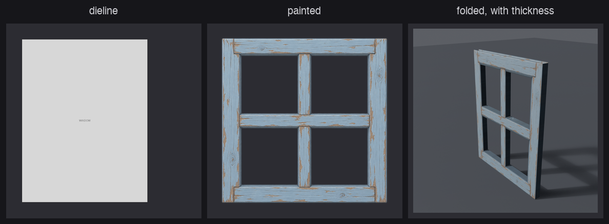

Table: a tray net top and one leg net placed four times.
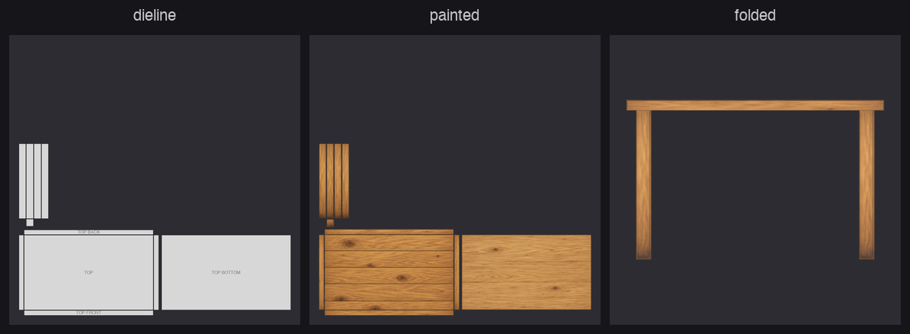

Tree: cone trunk and branches. The leaves are cards cut from a separate leaf sheet.
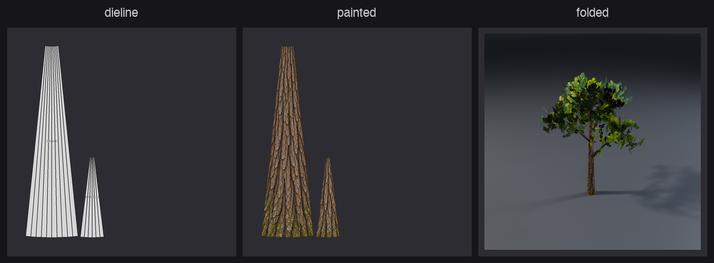

Morris column: five frustums. The cornice is a frustum turned upside down.
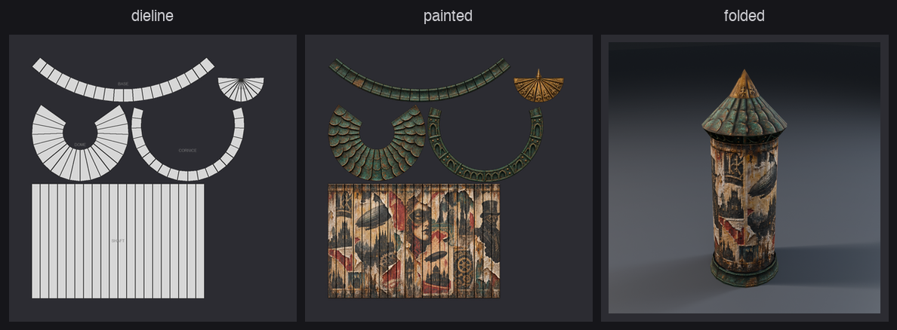

Market stall: boxes and an extruded gable awning.
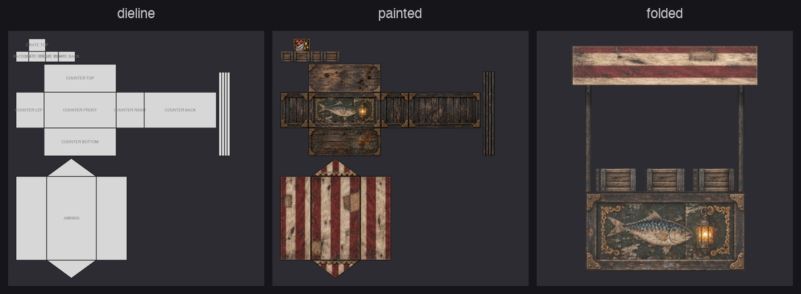

Handcart: an open box with 2.5 cm `thick` plank walls, an axle, wheels as short cylinders with both caps.
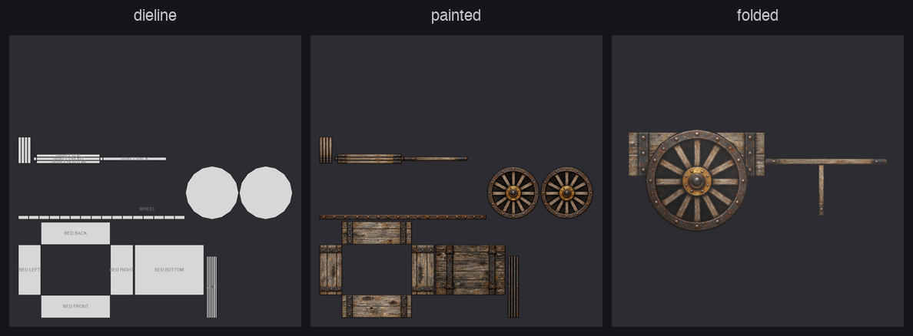

Water tower: a capped cylinder tank, a cone roof, box legs and a `thick` card ladder.
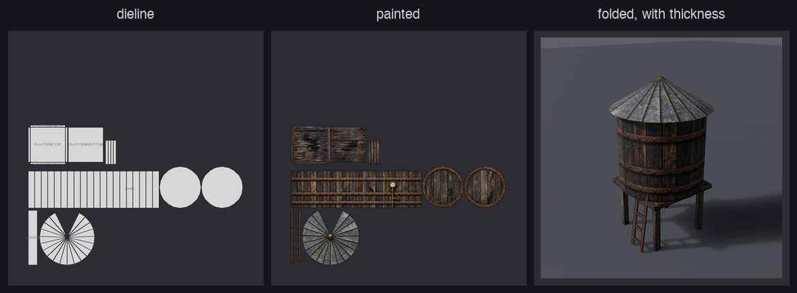

Flintlock: the image model refused to paint a pistol dieline. So it painted a sheet of plain material
swatches instead (brass, walnut, steel), and `swatch.py` placed them on each piece by code. Stock and lock are
extruded profiles, barrel, band and ramrod are cylinders, the trigger guard is a loop cut in a `thick` card.
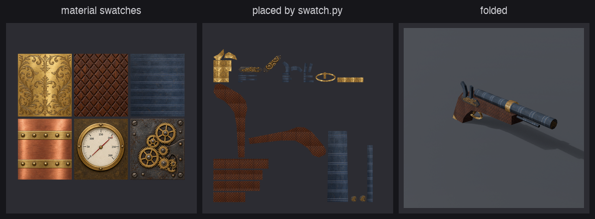

## Fold animation

`<name>_fold.glb` plays the flat sheet folding into the object. Box and card faces turn about their shared edges.
Cones roll up without stretching the paper. Parts fold in spec order. Leaves grow last.

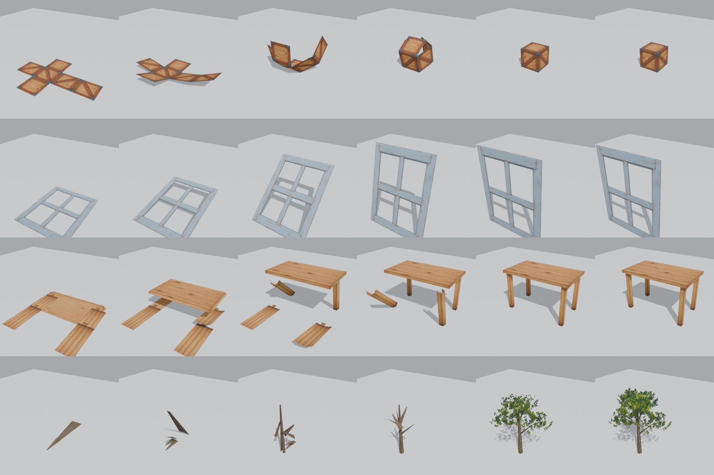

## Fallbacks

- `swatch.py`: when the image model refuses the object, paint one sheet of plain material swatches and place them
  per net or per face.
- `silhouette.py`: one side photo becomes an extruded profile with the photo on both caps. No image call.

## Costs

- About $0.10 to $0.25 per painted image (one per object, plus one leaf sheet per tree species).
- Everything else is free and local: unfolding, cleanup, folding, export, renders.
- `image.py --dry-run` prints the request and sends nothing. The skill asks before every paid call.

## Limits

- Simple shapes only. Organic forms (characters, rocks, roots) do not unfold well.
- The painter keeps shapes but not always scale. `template.py clean` fits it back and the gate checks it.
- A layout is tied to its painting. Change the spec and you repaint.
- Image moderation can refuse some objects (weapons). Use the swatch fallback, do not reword around the filter.
- The tree fold GLB is large (2.3 MB) because of 15 morph targets on 5240 verts.

## Tests

```bash
pip install pytest && python3 -m pytest tests
```

The tests cover the pure Python parts: every example layout folds back exactly, keeps its edge lengths mid fold
and starts flat, plus nets, caps, the paint cleanup and the gate.

## License

Code: [Apache License 2.0](LICENSE). Use it anywhere, commercial projects included. Keep the [NOTICE](NOTICE) file
in a redistribution or a fork.

Example assets in `examples/` (images, textures, GLB): [CC BY 4.0](examples/LICENSE). Free to reuse, with a credit
to lejrimostfa and a link to this repo.

If it helps your game or your video, a mention or a link is appreciated. GitHub's "Cite this repository" button
gives a ready citation ([CITATION.cff](CITATION.cff)).
